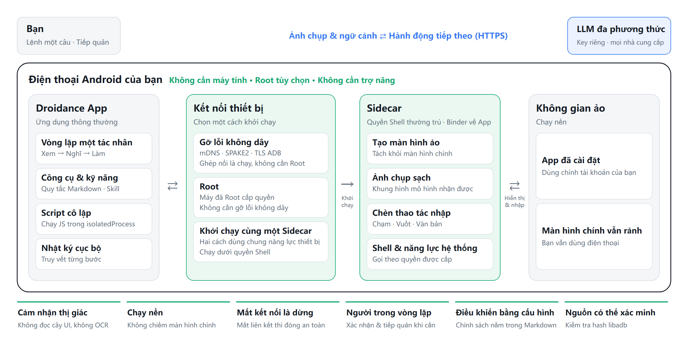

<div align="center">


# Droidance

### Let your Droid dance.

**Tác nhân vận hành Android sống ngay trên điện thoại của bạn, để điện thoại tự làm việc.**

Chỉ dùng thị giác · Chạy nền · Không cần Root · Không cần máy tính

Tiếng Việt | [English](README.en.md)

<br>

<a href="https://github.com/YbbLab/Droidance/releases/latest">
  
</a>

<br><br>

[](#-tải-về-và-bắt-đầu)
[](https://github.com/YbbLab/Droidance/actions/workflows/ci.yml)
[](LICENSE)
[](https://github.com/YbbLab/Droidance/stargazers)
[](https://github.com/YbbLab/Droidance/commits)

</div>

---

## 📖 Giới thiệu

**Droidance là một AI agent mã nguồn mở chạy trên điện thoại Android.** Bạn chỉ cần nói một câu, nó sẽ làm việc như một con người: nhìn màn hình, nghĩ bước tiếp theo rồi thao tác, và làm xong việc cho bạn ngay trong các App — so sánh giá, đặt món, tra cứu, đặt lịch, sắp xếp thông tin, chạy theo giờ…

Droidance **chỉ cần một API Key của LLM đa phương thức là chạy được**: không cần Root, không cần nối máy tính, cũng không cần bật dịch vụ trợ năng. Tác vụ chạy nền trong **không gian ảo** của điện thoại, bạn cứ chat, xem video, nghe điện thoại; nó lặng lẽ làm việc trên một "màn hình vô hình" khác. Nó **dựa vào ảnh chụp màn hình để hiểu giao diện**, không đọc cây UI, không phụ thuộc cây trợ năng — giao diện nào người hiểu được, nó cũng sẽ thử thao tác.

<table>
<tr>
<td width="33%" valign="top">

### 🔑 Một Key là dùng được

Không cần Root, máy tính, cáp dữ liệu hay phần cứng phụ. Cài xong App, hoàn tất ghép nối gỡ lỗi không dây, điền một API Key của LLM đa phương thức là có thể bắt đầu giao việc. Máy đã Root cũng có thể chọn kết nối Root. Người dùng đã bật Shizuku cũng có thể chọn Shizuku và cấp quyền.

</td>
<td width="33%" valign="top">

### 🌌 Chạy nền, không làm phiền bạn

Tác vụ chạy trong không gian ảo riêng, không chiếm màn hình chính. Bạn dùng điện thoại của bạn, nó làm việc của nó; khi cần, bạn cũng có thể chuyển sang xem hoặc tiếp quản bất cứ lúc nào.

</td>
<td width="33%" valign="top">

### 👁️ Điều khiển hoàn toàn bằng thị giác

Không dump cây XML, không dùng dịch vụ trợ năng. Những giao diện có cây trợ năng không đầy đủ như control tự vẽ hay WebView vẫn được thao tác bằng cách nhìn màn hình như người thật.

</td>
</tr>
</table>

---

## 📲 Tải về và bắt đầu

**Chuẩn bị:**

- Một chiếc điện thoại Android 11 trở lên. Thiết bị ít RAM và Android Go không được hỗ trợ.
- Kết nối gỡ lỗi không dây không cần Root, khi ghép nối cần Wi‑Fi; kết nối Root cần máy đã Root và đã cấp quyền Root cho Droidance. Dịch vụ mô hình vẫn cần kết nối mạng.
- Android 11–13 là hỗ trợ thử nghiệm: hệ thống không có focus riêng cho màn hình ảo, khi bấm phím và nhập văn bản sẽ tạm chiếm focus màn hình chính; trên Android 11, 12 tác vụ không thể tiếp tục sau khi khóa màn hình.
- Nếu Agent báo hệ thống chặn thao tác nhập, với máy Xiaomi hãy bật "Gỡ lỗi USB (cài đặt bảo mật)" trong Tùy chọn nhà phát triển; với OPPO, OnePlus, realme hãy tắt "Giám sát quyền", rồi kết nối lại thiết bị.
- Một API Key của LLM đa phương thức hỗ trợ đầu vào hình ảnh và gọi công cụ.

| Bước | Thao tác |
| :---: | :--- |
| **1** | Truy cập [Releases](https://github.com/YbbLab/Droidance/releases/latest) tải APK mới nhất và cài đặt |
| **2** | Trong “Kết nối thiết bị” chọn gỡ lỗi không dây, làm theo hướng dẫn mở “Tùy chọn nhà phát triển → Gỡ lỗi không dây” và nhập mã ghép nối; máy đã Root cũng có thể chọn Root và cấp quyền; người dùng đã bật Shizuku có thể chọn Shizuku và cho phép cấp quyền. **Toàn bộ không cần máy tính** |
| **3** | Thêm địa chỉ dịch vụ, API Key và mô hình của nhà cung cấp, rồi nói tác vụ của bạn trong một câu |

Xong. Tác vụ sẽ chạy nền, bạn có thể xem tiến độ, tạm dừng hoặc tiếp quản thao tác bất cứ lúc nào qua đảo chạy ở trên cùng.

> [!NOTE]
> Từ v0.1.9 đã hỗ trợ kết nối Root. Dự án vẫn đang ở giai đoạn xem trước, xem [CHANGELOG](CHANGELOG.md). Mỗi Release đều kèm file kiểm tra `.sha256` của APK, có thể đối chiếu trước khi cài.

> [!CAUTION]
> Dự án này chỉ dành cho học tập và nghiên cứu. Thao tác tự động có thể vi phạm điều khoản dịch vụ của một số App, có nguy cơ bị hạn chế tài khoản. Vui lòng đọc [tuyên bố miễn trừ trách nhiệm](#tuyên-bố-miễn-trừ-trách-nhiệm) trước khi sử dụng.

<details>
<summary><b>Build từ mã nguồn</b></summary>

Cần JDK 17 và Android SDK 35. Cấu hình `sdk.dir` trong `local.properties` ở thư mục gốc repo (file này đã bị Git bỏ qua), sau đó:

```bash
git clone https://github.com/YbbLab/Droidance.git
cd Droidance
./gradlew :app:assembleDebug
```

Chọn nhà cung cấp có sẵn, điền API key và model ID rồi lưu là dùng được. Địa chỉ API và giao thức đã được điền sẵn, không đặt model ID mặc định; cũng có thể thêm địa chỉ tùy chỉnh. Cấu hình đã có sẽ được giữ nguyên. Quá trình build không nhúng Key của máy vào APK.

Kiểm tra mã nguồn công khai (kiến trúc, tài nguyên, phụ thuộc native, Lint và APK Debug; test giữ lại cục bộ cũng chạy nếu có):

```bash
scripts/verify.sh
```

Quy ước phát triển và cách xác minh xem tại [CONTRIBUTING](CONTRIBUTING.md).

</details>

---

## ✨ Có thể làm gì

<table>
<tr>
<td width="33%" align="center" valign="top"><a href="assets/demos/compare.mp4"></a><br /><b>So sánh giá đa nền tảng</b><br /><sub>So sánh giá iPhone trên Pinduoduo, Tmall Flagship và JD Tự vận</sub></td>
<td width="33%" align="center" valign="top"><a href="assets/demos/tea.mp4"></a><br /><b>Đặt trà sữa</b><br /><sub>Chọn size và mã giảm giá, dừng ở trang đặt hàng chờ bạn xác nhận</sub></td>
<td width="33%" align="center" valign="top"><a href="assets/demos/meeting.mp4"></a><br /><b>Đặt lịch và chia sẻ cuộc họp</b><br /><sub>Đặt Tencent Meeting, gửi thông tin cuộc họp tới Trợ lý chuyển file của WeChat</sub></td>
</tr>
<tr>
<td width="33%" align="center" valign="top"><a href="assets/demos/train.mp4"></a><br /><b>Tra tàu cao tốc</b><br /><sub>Lọc các chuyến có ghế hạng hai buổi sáng ngày kia, tổng hợp giờ và giá vé</sub></td>
<td width="33%" align="center" valign="top"><a href="assets/demos/resale.mp4"></a><br /><b>Hỏi giá đồ cũ</b><br /><sub>Chọn 3 chiếc iPad trên Xianyu, nhắn hỏi lịch sự về pin và tình trạng sửa chữa</sub></td>
<td width="33%" align="center" valign="top"><a href="assets/demos/review.mp4"></a><br /><b>Đánh giá sản phẩm</b><br /><sub>Chấm điểm và gửi đánh giá cho sản phẩm đang chờ trên JD</sub></td>
</tr>
</table>

<sub>Video demo đã được biên tập, một số thao tác được tua nhanh, thông tin riêng tư đã được che. Bấm vào ảnh động để xem video đầy đủ.</sub>

**Khả năng khác**

- **Người trong vòng lặp**: xác minh con người (CAPTCHA) luôn do bạn thực hiện; khi gặp các bước cần bạn tự quyết như thanh toán, mật khẩu, cấp quyền đăng nhập, agent sẽ tạm dừng và nhờ bạn tiếp quản. Bạn cũng có thể tiếp quản bất cứ lúc nào, làm xong rồi trả lại cho nó.
- **Tác vụ định giờ**: hỗ trợ lịch chạy một lần, hằng ngày/hằng tuần và theo khoảng thời gian cố định, đến giờ tự chạy.
- **Tích lũy kỹ năng**: biến những quy trình hiệu quả đã tìm ra thành kỹ năng (Skill) tái sử dụng, lần sau nạp khi cần, càng dùng càng quen tay.
- **Năng lực hệ thống**: sau khi bạn cấp quyền, có thể trực tiếp đọc/ghi dữ liệu hệ thống như lịch, danh bạ, SMS, không cần thao tác giao diện từng bước.
- **Tự do chọn mô hình**: có thể kết nối endpoint tương thích OpenAI hỗ trợ đầu vào hình ảnh và gọi công cụ; địa chỉ dịch vụ, API Key và mô hình đều do bạn tự cấu hình.

**So sánh với các cách phổ biến**

| | Cách điều khiển bằng ADB từ máy tính | Agent dựa trên dịch vụ trợ năng | **Droidance** |
| :--- | :---: | :---: | :---: |
| Không cần máy tính / USB | ❌ | ✅ | ✅ |
| Không cần Root | ✅ | ✅ | ✅ |
| Không phụ thuộc cây UI / dịch vụ trợ năng | ⚠️ Tùy cách hiện thực | ❌ | ✅ |
| Khi chạy không chiếm màn hình chính | ❌ | ❌ | ✅ |
| Bước nhạy cảm thì dừng, người tiếp quản | ⚠️ | ⚠️ | ✅ |

---

## 🏗️ Kiến trúc kỹ thuật và cơ chế hoạt động

<picture>
  <source media="(prefers-color-scheme: dark)" srcset="assets/architecture/architecture-vi-dark.png" />
  
</picture>

### Nó chạy trên điện thoại Android như thế nào

1. **ADB tích hợp, điện thoại tự kết nối chính mình**: App tích hợp sẵn client gỡ lỗi không dây đầy đủ: dùng mDNS tìm cổng của máy, dùng `libadb.so` (BoringSSL) hoàn tất ghép nối SPAKE2, rồi client TLS ADB viết bằng Kotlin kết nối tới `adbd` của hệ thống bằng khóa RSA cục bộ, để khởi chạy một tiến trình thực thi thường trú dưới quyền Shell (Sidecar). Không cần Root, cũng không cần máy tính. Máy đã Root cũng có thể cấp quyền để App khởi chạy cùng một Sidecar qua Root, không cần gỡ lỗi không dây.
2. **Tạo không gian ảo**: Sidecar tạo trên điện thoại một màn hình ảo tách biệt. App mở trên màn hình đó, dùng chính các ứng dụng đã cài và tài khoản đã đăng nhập trên máy bạn, không phải một bản sao dữ liệu khác.
3. **Cảm nhận thuần thị giác**: agent chỉ đọc ảnh chụp màn hình ảo, khi cần thì phóng to cục bộ để xem chi tiết. Không đọc cây UI, không dùng dịch vụ trợ năng, cũng không phụ thuộc mô hình OCR cục bộ.
4. **Quyết định bởi một tác nhân duy nhất**: cùng một tác nhân dựa trên hình ảnh và ngữ cảnh, tự chọn trả lời trực tiếp, gọi năng lực hệ thống (lịch, SMS, danh bạ…), chạy script cô lập, hay thao tác giao diện. Không có bộ phân loại ý định hay bộ lập kế hoạch riêng, một vòng lặp đi tới cùng.
5. **Thực thi và báo cáo**: chạm, nhập, vuốt đều gửi tới cùng một màn hình ảo. Sau mỗi bước thực thi lại quan sát màn hình, xác nhận hiệu quả rồi mới quyết định bước tiếp. Toàn bộ quá trình được ghi lại cục bộ, khi tác vụ kết thúc thì báo kết quả cho bạn (trong App và qua thông báo cục bộ).

### Thành phần module

| Module | Trách nhiệm |
| --- | --- |
| `app` | Host Android, giao diện, cài đặt và dịch vụ runtime |
| `core:agent` | Vòng lặp quyết định của agent, vòng đời tác vụ, giao thức công cụ và quản lý ngữ cảnh |
| `core:model` | Lớp trừu tượng mô hình, adapter từng nhà cung cấp và giao thức streaming |
| `core:device` | Sidecar, chụp màn hình, nhập liệu, năng lực hệ thống và thực thi script cô lập |
| `core:knowledge` | Kỹ năng, bộ nhớ và lưu trữ tài liệu |
| `core:persistence` | Lưu trữ cục bộ sự kiện và tri thức |

Quy tắc và chính sách của agent nằm trong cấu hình Markdown (`app/src/main/assets/rules/`, `skills/`), Kotlin chỉ đảm nhận điều phối chung, kiểm tra giao thức, thực thi trên thiết bị và lưu trữ.

---

## 🔒 Quyền riêng tư và bảo mật

**Dữ liệu đi đâu**

- **Ưu tiên cục bộ**: hội thoại, kỹ năng và bản ghi thực thi chỉ lưu trên thiết bị của bạn, không có thống kê hay telemetry của bên thứ ba.
- **Yêu cầu tới mô hình**: chỉ thị tác vụ, ngữ cảnh và ảnh chụp màn hình sẽ được gửi tới **nhà cung cấp mô hình do chính bạn cấu hình**, yêu cầu đi thẳng tới endpoint đó, không qua máy chủ của Droidance. Vui lòng tìm hiểu chính sách riêng tư của nhà cung cấp tương ứng.
- **Bạn giữ thông tin đăng nhập**: API Key lưu trong vùng lưu trữ riêng của ứng dụng, khi chạy được truyền vào bộ nhớ của tiến trình dưới quyền Shell. Dữ liệu chạy và lịch sử nằm trong thư mục do Shell sở hữu trên thiết bị; gỡ cài đặt ứng dụng không tự xóa thư mục này; thư mục còn lại từ bản cũ đã gỡ có thể vẫn chứa bản sao thông tin đăng nhập. Chi tiết xem [SECURITY](SECURITY.md).
- **Chẩn đoán cục bộ**: ứng dụng tự động lưu yêu cầu, phản hồi mô hình và ảnh chụp để khắc phục sự cố; trong đó vẫn có thể chứa thông tin cá nhân. Mục tiêu dọn dẹp là 7 ngày và 512 MiB, nhưng việc dọn chỉ được cố gắng thực hiện ở các yêu cầu sau, tác vụ hiện tại không tham gia dọn dẹp, nên đây không phải giới hạn lưu trữ hay dung lượng nghiêm ngặt. Có thể xóa bản ghi chẩn đoán tại “Cài đặt → Quản lý dữ liệu → Dọn nhật ký chạy”; hội thoại, tệp đính kèm phát lại và bộ nhớ cần quản lý riêng. Bản xuất chẩn đoán có thể chứa những nội dung này, hãy kiểm tra trước khi chia sẻ.
- **Cập nhật ứng dụng**: khi kiểm tra cập nhật sẽ truy cập GitHub API; khi tải trực tiếp thất bại sẽ chuyển sang mirror `ghproxy.net`, giá trị kiểm tra của gói cài luôn lấy từ GitHub API.

**Mục đích của các quyền**

| Quyền / năng lực | Mục đích |
| --- | --- |
| Ghép nối gỡ lỗi không dây | Khởi chạy tiến trình điều khiển thiết bị dưới quyền Shell, không cần Root |
| Cấp quyền Root (tùy chọn) | Khởi chạy cùng tiến trình điều khiển thiết bị dưới quyền Shell, không cần gỡ lỗi không dây |
| Cấp quyền Shizuku (tùy chọn) | Khởi chạy cùng tiến trình điều khiển thiết bị qua Shizuku đang chạy |
| Lịch, danh bạ, SMS, lịch sử cuộc gọi | Sau khi bạn cấp quyền, agent có thể đọc/ghi theo tác vụ như năng lực hệ thống |
| Quyền truy cập thông báo | Đọc nội dung thông báo cho tác vụ và tự động hóa |
| Bàn phím Droidance | Nhập văn bản trên màn hình ảo |
| Truy vấn danh sách ứng dụng | Tìm và khởi chạy App mục tiêu theo tên |
| Báo thức chính xác, khởi động cùng máy, miễn tối ưu pin | Tác vụ định giờ chạy đúng giờ và khôi phục |
| Cài đặt ứng dụng không rõ nguồn gốc | Cài bản cập nhật tải trong ứng dụng |

Quyền runtime có thể thu hồi bất cứ lúc nào trong cài đặt hệ thống. Sau khi ghép nối gỡ lỗi không dây thành công, Sidecar không phụ thuộc Wi‑Fi, bị kill sẽ tự khởi động lại; đặt lại ghép nối hoặc khởi động lại máy có thể dừng nó, sau khi tắt tùy chọn nhà phát triển nó không tự khởi động lại nữa. Sau khi cập nhật ứng dụng cần khởi chạy Sidecar khớp với bản mới; nếu không tự khôi phục được, hãy bật gỡ lỗi không dây để kết nối lại, hoặc dùng Root trên máy đã Root. Chế độ Root dùng quyền Root để khởi chạy và khôi phục kênh; sau khi thu hồi quyền, lần khởi chạy hoặc khôi phục mới sẽ thất bại. Vấn đề bảo mật vui lòng báo cáo riêng theo [SECURITY](SECURITY.md).

**Ranh giới**

- **Xác nhận thủ công**: việc có dừng lại để trao cho bạn hay không do agent phán đoán theo quy tắc, không phải chặn cứng. Với thao tác liên quan tới tiền bạc, riêng tư hay không thể đảo ngược, hãy để nó dừng ở trang xác nhận, bạn tự kiểm tra và gửi.
- **Không xâm nhập**: không Hook, không inject, không sửa bất kỳ App bên thứ ba nào.

---

## 📱 Tương thích và hạn chế đã biết

- Ghép nối gỡ lỗi không dây và khôi phục kết nối sau khi khởi động lại máy cần Wi‑Fi; một số hệ thống sẽ tắt gỡ lỗi không dây sau khi mất mạng, khởi động lại hoặc để lâu, cần bật lại khi dùng.
- Shizuku cần cài riêng và khởi chạy qua ADB hoặc gỡ lỗi không dây; sau khi khởi động lại máy cần khởi chạy lại. Với Shizuku khởi chạy bằng Root, hãy chuyển sang kết nối Root của Droidance. Khi Shizuku dừng, miễn là kênh thiết bị sẵn có vẫn dùng được thì tác vụ có thể tiếp tục.
- Kết nối Root đã được xác minh trên máy thật với Android 16 và SukiSU; hành vi với trình quản lý Root hoặc thiết bị khác có thể không giống.
- Một số hệ thống của nhà sản xuất hạn chế chạy nền, nên cho phép Droidance chạy nền và tắt tối ưu pin trong cài đặt hệ thống.
- Một số App phát hiện tùy chọn nhà phát triển hoặc gỡ lỗi không dây đang bật, có thể từ chối chạy hoặc hạn chế tính năng.
- Tỷ lệ hoàn thành và thời gian tác vụ phụ thuộc vào năng lực thị giác và suy luận của mô hình được dùng; agent báo "hoàn thành" không có nghĩa kết quả nghiệp vụ nhất định đúng, kết quả quan trọng hãy tự kiểm tra.

---

## 🗺️ Kế hoạch phát triển

- [ ] Chế độ Pro và Ultra: hỗ trợ thêm nhiều thao tác nâng cao và mở khóa chế độ Geek
- [ ] Tác nhân con: hỗ trợ tác nhân con chạy song song trên nhiều không gian ảo

---

## 🤝 Đóng góp

Hoan nghênh phản hồi vấn đề, đề xuất ý tưởng qua [Issue](https://github.com/YbbLab/Droidance/issues), hoặc trực tiếp gửi Pull Request. Trước khi bắt đầu vui lòng đọc:

- [Hướng dẫn đóng góp](CONTRIBUTING.md): môi trường phát triển, quy ước kiến trúc và cách xác minh
- [Quy tắc ứng xử](CODE_OF_CONDUCT.md)
- [Chính sách bảo mật](SECURITY.md): lỗ hổng bảo mật vui lòng báo riêng qua GitHub, không gửi Issue công khai

Theo dõi chúng tôi: [X](https://x.com/ybblab2026) · [YouTube](https://www.youtube.com/@ybblab) · [Bilibili](https://space.bilibili.com/3706972849310516) · [Xiaohongshu](https://www.xiaohongshu.com/user/profile/69cb432b0000000032025c5e)

<a href="https://github.com/YbbLab/Droidance/graphs/contributors">
  
</a>

---

## 📄 Giấy phép

Dự án này mã nguồn mở theo [Apache License 2.0](LICENSE). Bạn có thể tự do sử dụng, sửa đổi và phân phối (kể cả cho mục đích thương mại), nhưng cần tuân thủ các yêu cầu sau:

- **Giữ thông báo**: khi phân phối mã nguồn hoặc bản binary, hãy giữ nguyên thông báo bản quyền, file [LICENSE](LICENSE) và [NOTICE](NOTICE).
- **Ghi rõ sửa đổi**: nếu sửa file nguồn, hãy ghi chú trong chính những file đã sửa.
- **Không mạo danh**: giấy phép không cấp quyền nhãn hiệu đối với tên và Logo Droidance, sản phẩm phái sinh dựa trên dự án này không được phát hành hay quảng bá dưới danh nghĩa chính thức.
- **Thành phần bên thứ ba**: các thành phần bên thứ ba trong dự án tuân theo giấy phép riêng của chúng, xem [NOTICE](NOTICE) và [giấy phép đi kèm mã nguồn](app/src/main/assets/licenses/).

### Tuyên bố miễn trừ trách nhiệm

> [!IMPORTANT]
> Dưới đây là những lưu ý về rủi ro khi sử dụng, không giới hạn các quyền mà [Apache License 2.0](LICENSE) cấp.

1. **Tuân thủ pháp luật áp dụng**: đây là dự án mã nguồn mở hướng tới agent di động; khi sử dụng hãy tuân thủ pháp luật áp dụng và điều khoản dịch vụ của bên thứ ba.
2. **Tự chịu rủi ro tài khoản**: thao tác tự động có thể vi phạm thỏa thuận người dùng của App bên thứ ba, **có thể khiến tài khoản bị cảnh cáo, hạn chế, khóa hoặc mất dữ liệu**, rủi ro do người dùng tự chịu. Khuyến nghị không dùng trên tài khoản quan trọng.
3. **Tránh lạm dụng**: vui lòng không dùng dự án này để đặt đơn ảo, tăng tương tác ảo, đăng ký hàng loạt, mua sắm ác ý, vượt qua kiểm soát rủi ro hoặc CAPTCHA, thu thập thông tin người khác khi chưa được phép, quấy rối, lừa đảo hay bất kỳ hành vi trái pháp luật hoặc xâm hại quyền lợi người khác.
4. **AI có thể sai**: quyết định của mô hình lớn có tính không chắc chắn, có thể chạm nhầm, nhập nhầm. Với thao tác liên quan tới tiền bạc, riêng tư hay không thể đảo ngược, nhất định phải xác nhận thủ công. Tác giả và người đóng góp không chịu trách nhiệm cho bất kỳ tổn thất trực tiếp hay gián tiếp nào do việc dùng dự án này gây ra.
5. **Dịch vụ bên thứ ba**: ảnh chụp màn hình và dữ liệu khác sẽ được gửi tới nhà cung cấp mô hình do chính bạn cấu hình, hãy tìm hiểu và tuân thủ chính sách riêng tư cùng điều khoản sử dụng của họ.
6. **Không liên kết**: dự án này không liên kết với bất kỳ App hay nhà cung cấp bên thứ ba nào được nhắc tới trong tài liệu; các nhãn hiệu liên quan thuộc về chủ sở hữu tương ứng.

---

## 📈 Hoạt động dự án

<a href="https://star-history.com/#YbbLab/Droidance&Date">
  <picture>
    <source media="(prefers-color-scheme: dark)" srcset="https://api.star-history.com/svg?repos=YbbLab/Droidance&type=Date&theme=dark" />
    
  </picture>
</a>

<div align="center">

**Nếu Droidance khiến điện thoại của bạn "nhảy múa", hãy thả cho chúng tôi một ⭐.**

</div>
